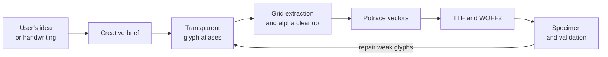

<div align="center">

# Turn a visual idea into an installable font

**Font Maker is a Codex skill that captures the user's creative direction, generates coherent transparent glyph atlases, and deterministically compiles them into validated TTF and WOFF2 font prototypes.**

[](https://github.com/ali-abassi/font-maker-skill/actions/workflows/ci.yml)

[Install](#install-the-skill) · [Try the included atlas](#try-the-included-atlas) · [How it works](#how-it-works) · [Limits](#honest-limits)


</div>

## Why this exists

Image models can invent beautiful letterforms, but an image of an alphabet is
not a font. The hard part is preserving character identity, extracting clean
outlines, aligning metrics, compiling real font tables, and proving that the
result survives actual words.

Font Maker gives Codex the creative and mechanical workflow:

- asks a few plain-language questions to understand the user's idea;
- generates related glyphs together for a coherent visual hand;
- uses a known grid and real transparency for deterministic extraction;
- traces and compiles installable `.ttf` and `.woff2` files;
- renders a specimen and checks every mapped outline before delivery.

## Install the skill

Clone the repository directly into the Codex skills directory:

```sh
git clone https://github.com/ali-abassi/font-maker-skill.git ~/.codex/skills/font-maker
```

Then start a new Codex session and ask:

```text
$font-maker Make me a hurried blue-ballpoint cursive font for editorial headlines.
```

Codex can invoke it automatically for requests to invent, extract, compile, or
extend a font. The skill uses the available image-generation workflow for the
creative atlas step; the included compiler does not require an API key.

## Try the included atlas

The repository includes the real transparent uppercase atlas used to make the
Blue Thread specimen above.

Install [Potrace](https://potrace.sourceforge.net/) and the Python dependencies:

```sh
brew install potrace
python3 -m venv .venv
.venv/bin/pip install -r scripts/requirements.txt
```

Compile the atlas:

```sh
.venv/bin/python scripts/font_pipeline.py examples/blue-thread/font-manifest.json --output-dir output
```

The verified build reports:

```text
PASS — 26 outline glyphs, 27 mapped codepoints, TTF + WOFF2
```

Open `output/build/Blue-Thread-Regular.ttf` to install the font, or inspect
`output/build/Blue-Thread-specimen.png` first.

Linux users can install Potrace with their package manager—for example,
`sudo apt-get install potrace` on Ubuntu—and use the same Python commands.

## How it works



The agent handles judgment; the scripts handle repeatable mechanics:

1. `references/intake.md` turns everyday language into a focused font brief.
2. `references/atlas-generation.md` defines exact grid prompts, reference-image
   roles, transparency requirements, and repair strategy.
3. `scripts/make_grid_template.py` creates a neutral structural reference if an
   image model repeatedly omits or reorders letters.
4. `scripts/font_pipeline.py` crops cells, removes disconnected generation dust,
   traces alpha masks, converts curves to TrueType quadratics, compiles both font
   formats, renders a proof, and validates the result.

## What the user gets

Each completed project can contain:

```text
font-project/
├── font-manifest.json
├── assets/
│   └── uppercase-atlas.png
└── output/
    ├── build/
    │   ├── Family-Regular.ttf
    │   ├── Family-Regular.woff2
    │   ├── Family-specimen.png
    │   └── build-report.json
    └── glyphs/
        ├── png/
        ├── mask/
        └── svg/
```

Intermediate filenames use Unicode codepoints (`u0041`, `u0061`) so uppercase
and lowercase glyphs remain distinct on case-insensitive filesystems.

## Use it when

- inventing an original display font from a mood, material, or visual metaphor;
- turning the user's own handwriting or authorized references into a prototype;
- compiling an existing transparent glyph atlas;
- extending a successful uppercase concept into lowercase, figures, or symbols;
- diagnosing why a generated alphabet fails as real text.

Use a conventional type-design editor instead when you need precise manual
Bezier editing, advanced kerning, hinting, variable axes, or production-quality
OpenType shaping. FontForge, Glyphs, RoboFont, and FontLab provide finer direct
control for that stage.

## Honest limits

- The included example is an uppercase display-font proof, not a complete text
  family.
- Geometry checks cannot determine whether a stylized `R` is visually the right
  letter; the agent must inspect every atlas before mapping it to Unicode.
- Cursive bearings can make strokes nearly meet, but natural contextual joining
  generally requires entry/exit alternates and OpenType features.
- A normal outline font has no intrinsic blue color. Applications choose color;
  the specimen uses cobalt blue for presentation.
- Generated output is not automatic originality, trademark, or production
  clearance. Use only handwriting and references you are authorized to adapt.

## Repository map

- [`SKILL.md`](SKILL.md) — the agent workflow and invariants.
- [`scripts/font_pipeline.py`](scripts/font_pipeline.py) — deterministic compiler.
- [`scripts/make_grid_template.py`](scripts/make_grid_template.py) — ordering fallback.
- [`references/intake.md`](references/intake.md) — creative interview.
- [`references/atlas-generation.md`](references/atlas-generation.md) — generation recipe.
- [`references/manifest.md`](references/manifest.md) — compiler input contract.
- [`examples/blue-thread`](examples/blue-thread) — real transparent source atlas.

## License

[MIT](LICENSE) © 2026 Ali Abassi.
